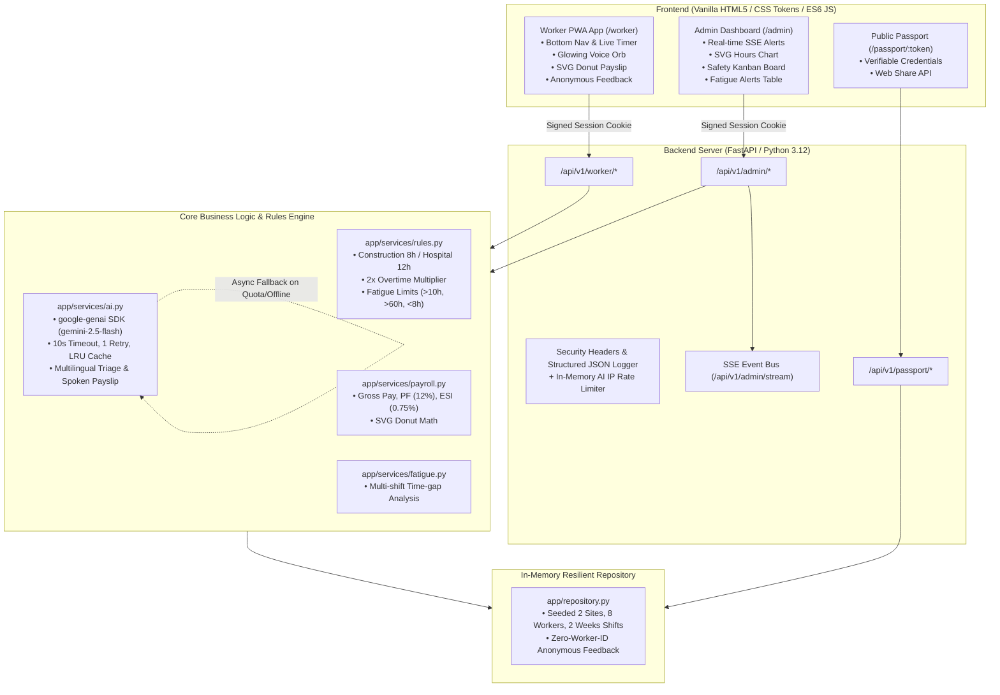

# FairShift — UN SDG 8 Decent Work Platform

> **A premium decent-work platform protecting shift workers across Construction and Hospital sectors with transparent 2x overtime compensation, voice-first AI hazard triage, fatigue violation guards, and portable skill passports.**

[](https://sdgs.un.org/goals/goal8)
[](https://www.python.org/)
[](https://fastapi.tiangolo.com/)
[](https://cloud.google.com/run)
[]()

---

## 1. Problem Statement

Shift workers in high-risk sectors (construction sites, emergency hospitals) face chronic labor vulnerabilities:
- **Overtime Wage Theft**: Informal and opaque bookkeeping cheats workers out of mandatory legal overtime multipliers.
- **Dangerous Fatigue & Accidents**: Shift lengths exceeding 10 hours and sub-8-hour rest gaps between consecutive rotations cause acute physical exhaustion and catastrophic workplace fatalities.
- **Language & Literacy Barriers**: Incident reporting systems rely on complex English text forms that low-literacy migrant workers cannot use when physical safety is threatened.
- **Retaliation Fears**: Workers cannot report unsafe site conditions or abusive contractor managers without risking immediate dismissal.
- **Credential Lock-In**: Skilled tradespeople cannot carry their safety certifications and accident-free track records to new sites or employers.

**FairShift** operationalizes **UN Sustainable Development Goal 8 (Decent Work & Economic Growth)** by providing automated sector labor rules, a multilingual glowing Voice Orb for incident triage, proactive fatigue prevention, guaranteed anonymity, and portable digital skill passports.

---

## 2. Feature &rarr; Pain Point &rarr; UN SDG 8 Mapping

| FairShift Feature | Shift Worker Pain Point Addressed | UN SDG 8 Target Alignment |
| :--- | :--- | :--- |
| **Automated 2x Overtime Shift Engine** | Unrecorded overtime hours, wage deductions, and wage theft. | **Target 8.5**: Full & productive employment with equal pay for work of equal value. |
| **Multilingual Voice Orb AI Triage** | Inability to report hazards due to language/literacy barriers (English forms). | **Target 8.8**: Protect labour rights and promote safe and secure working environments. |
| **Fatigue Violation Early-Warning Engine** | Life-threatening exhaustion from &gt;10h shifts, &gt;60h weeks, &lt;8h rest. | **Target 8.8**: Safe working environments and prevention of occupational fatalities. |
| **Cryptographic Anonymized Feedback** | Retaliation, termination, and blacklisting for voicing site concerns. | **Target 8.8**: Protection of labor rights and workplace dignity. |
| **Verifiable Portable Skill Passport** | Loss of hard-earned safety credentials and experience when changing sites. | **Target 8.6 & 8.5**: Lifelong skills development, credentials portability, and decent work. |

---

## 3. Sector-Specific Use Cases

### 🏗️ Construction Sector ("Skyline Construction Site, Chennai")
- **Standard Rule**: 8 hours/day limit. All duty beyond 8 hours is automatically compensated at **2.0x base wage** (₹150/hr &rarr; ₹300/hr OT).
- **Fatigue Scenario**: Scaffolders pouring high-rise concrete slabs past 10 hours trigger an instant red **Fatigue Alert** on the Admin dashboard and an amber warning banner on the worker's mobile screen.
- **Voice Safety Scenario**: A worker spots loose scaffold clamps on the 4th floor external lift shaft. They tap the glowing teal Voice Orb and speak in Tamil or Hindi (*"4வது மாடி வெளிப்புற லிப்ட் ஷாஃப்ட்டில் சாரக்கட்டு தளர்வாக உள்ளது"*). Gemini extracts strict JSON `{category: "hazard", severity: "critical"}`, pushes an instant SSE red toast to the site engineer, and creates a tracked Kanban card.

### 🏥 Hospital Sector ("City Care Hospital, Chennai")
- **Standard Rule**: 12 hours/shift rotational duty. Hours exceeding 12h are multiplied at **2.0x base wage** (₹180/hr &rarr; ₹360/hr OT).
- **Fatigue Scenario**: An ICU nurse finishes a night shift at 22:00 and is assigned an emergency morning rotation starting at 04:00 (only 6h rest gap). The fatigue engine flags `<8h recovery rest violation (Critical)` and prompts administrative re-assignment.
- **Voice Safety Scenario**: An emergency triage nurse identifies an overflowing biohazard sharps container. Speaking into the Voice Orb immediately categorizes the biohazard risk and notifies facilities.

---

## 4. Architecture & System Design



---

## 5. Pre-Seeded Evaluation Credentials

FairShift starts with rich, realistic Indian shift worker data pre-seeded:

| Role / View | Sector | Name | Mobile / Auth | PIN | Pre-Seeded Context |
| :--- | :--- | :--- | :--- | :--- | :--- |
| **Worker View** | Construction | Rajesh Kumar | `9876543210` | `1234` | Has active shift running (live timer demo), 13h fatigue case. |
| **Worker View** | Hospital | Priya Sharma | `9876543220` | `1234` | Emergency nurse, 12h shifts, 6h insufficient rest fatigue case. |
| **Admin Portal** | Both Sites | Safety Officer | N/A | `4821` | Full Kanban, SVG bar chart, live SSE alerts, fatigue table. |
| **Skill Passport** | Construction | Rajesh Kumar | Public URL: `/passport/pass-rajesh-k892` | None | OSHA 30h certified, height safety, portable across employers. |

---

## 6. Local Setup & Testing

### Prerequisites
- Python 3.12+
- Pip

### 1. Clone & Setup Environment
```bash
git clone <repo-url>
cd Fairshift

# Create and activate virtual environment (optional)
python -m venv venv
# On Windows:
venv\Scripts\activate
# On Linux/macOS:
source venv/bin/activate

# Install dependencies
pip install -r requirements.txt
```

### 2. Configure Environment Variables
Copy `.env.example` to `.env`:
```bash
cp .env.example .env
```
Edit `.env` as needed:
```env
PORT=8080
GEMINI_API_KEY=your_gemini_api_key_here
GEMINI_MODEL=gemini-2.5-flash
ADMIN_PIN=4821
SESSION_SECRET=fairshift-super-secret-random-123
ALLOWED_ORIGINS=*
```
*(Note: If `GEMINI_API_KEY` is not provided or offline, FairShift automatically uses an intelligent local fallback so every button and voice flow works flawlessly.)*

### 3. Run Automated Tests
```bash
python -m pytest -v
```
All 14 tests will pass:
- Overtime calculation (Construction 8h vs Hospital 12h)
- 2x overtime fair wage multiplier
- Fatigue violation detection (&gt;10h/day, &gt;60h/week, &lt;8h rest)
- Statutory payslip totals (PF 12%, ESI 0.75%, net pay)
- Strict anonymity assertion (feedback stores NO worker ID)
- Admin and worker authentication guards
- Pydantic input validation
- Health endpoint (`/health`)
- Mocked Gemini AI incident triage

### 4. Run Application Locally
```bash
python -m uvicorn app.main:app --host 0.0.0.0 --port 8080 --reload
```
Navigate to:
- **Landing Page**: `http://localhost:8080/`
- **Worker App**: `http://localhost:8080/worker`
- **Admin Dashboard**: `http://localhost:8080/admin`
- **Skill Passport**: `http://localhost:8080/passport/pass-rajesh-k892`
- **API Swagger Docs**: `http://localhost:8080/docs`

---

## 7. Deployment to Google Cloud Run

FairShift is built as a stateless, containerized FastAPI application with environment-driven port binding (`$PORT`, default 8080) and a non-root user.

### Deploy via Google Cloud CLI:
```bash
# 1. Authenticate with GCP
gcloud auth login
gcloud config set project YOUR_PROJECT_ID

# 2. Build and deploy directly to Cloud Run
gcloud run deploy fairshift \
  --source . \
  --region asia-south1 \
  --platform managed \
  --allow-unauthenticated \
  --set-env-vars "ADMIN_PIN=4821,SESSION_SECRET=$(openssl rand -hex 16),GEMINI_API_KEY=YOUR_KEY,GEMINI_MODEL=gemini-2.5-flash"
```

---

## 8. Accessibility & Security

- **WCAG AA Compliance**: High-contrast dark and light themes, minimum 48px touch targets, visible focus rings, full keyboard accessibility.
- **Multilingual Support**: English, Hindi (हिंदी), and Tamil (தமிழ்) with dynamic `<html lang>` updates and full i18n JSON bundles.
- **Security**: PBKDF2 with SHA-256 password hashing (100,000 iterations), signed HttpOnly session cookies, CSP and security headers, strict IP rate limiting on AI endpoints, and zero storage of worker identity with feedback.
